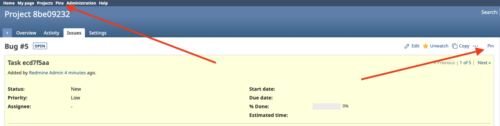
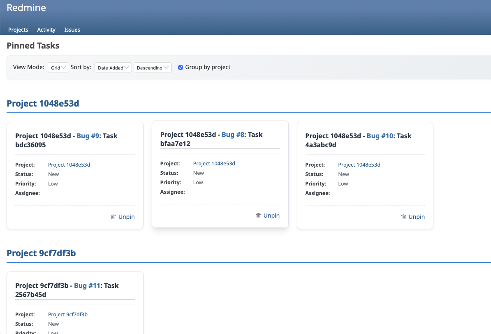
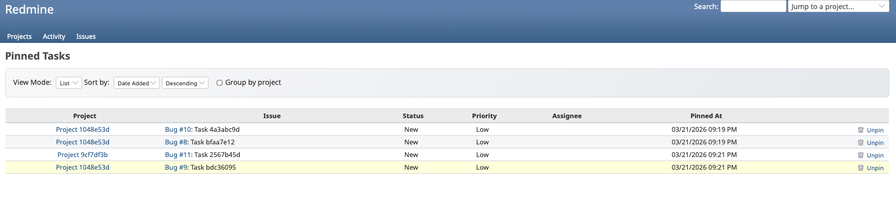
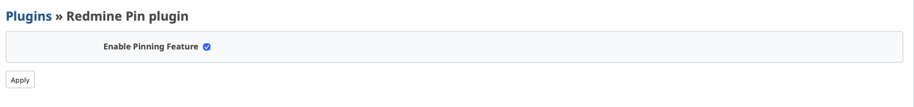

# Redmine Pin Plugin

A Redmine plugin that allows users to independently pin their favorite issues to a private pin board for quick access.

Compatible with Redmine 6.0+ and 7.0 (Rails 7.2 / 8.1).

## Screenshots

### Pinning an Issue


### Pin Board (Grid View)


### Pin Board (List View)


### Plugin Settings


## Features

- Add and manage pinned tasks with a single click inside any issue.
- Dedicated "Pins" dashboard available in the top menu.
- Display pins in a classic List view or a modern Grid view.
- Group, sort, and filter your favorite tasks by project, date, status, priority, subject, and assignee.
- Instant AJAX unpinning from the Pins dashboard.

## Installation

1. Copy the plugin directory to your Redmine `plugins` folder:
   ```bash
   cd /path/to/redmine/plugins
   git clone https://github.com/jonasliu95/redmine_pin.git
   ```

2. Run the plugin migrations:
   ```bash
   cd /path/to/redmine
   bundle exec rake redmine:plugins:migrate NAME=redmine_pin RAILS_ENV=production
   ```

3. Precompile the assets (required in production):
   ```bash
   bundle exec rake assets:precompile RAILS_ENV=production
   ```

4. Restart your Redmine instance:
   ```bash
   # For Passenger
   touch tmp/restart.txt

   # For other servers, restart accordingly
   ```

5. Go to **Administration → Plugins** to verify the plugin is loaded.

## Configuration

1. Navigate to **Administration → Plugins**
2. Find "Redmine Pin plugin" and click **Configure**
3. Tick **Enable pinning** and save the settings.

Disabling the plugin removes the "Pins" menu entry and the pin button from issues,
and both `/pins` and `/pins/toggle` respond with **403 Forbidden**. Existing pins are
kept in the database and become visible again when the plugin is re-enabled.

Only issues the user is allowed to see are listed on `/pins`, and an issue that is no
longer visible cannot be pinned.

## Usage

1. Open any issue in your Redmine instance.
2. Click the **Pin** button located in the contextual menu (next to Edit, Log time, Copy).
3. Click the **Pins** menu item in the top navigation bar to access your personal pin board.
4. From the Pins dashboard, you can view your pinned issues, toggle between Grid and List views, sort, group, and unpin tasks.

## Compatibility

| Locale | Status |
|--------|--------|
| en     | Full support |
| lt     | Full support |
| de     | Full support |
| es     | Not supported |
| fr     | Not supported |
| it     | Not supported |
| ja     | Not supported |
| ru     | Not supported |

Not supported means that the plugin is translated, but without proper QA of the translation.

## Translations

To add a new translation, simply copy the `config/locales/en.yml` file to your desired language code (e.g., `de.yml`) and translate the values. Contributions via pull requests are highly encouraged!

## Upgrade

```bash
cd /path/to/redmine/plugins/redmine_pin
git pull
cd /path/to/redmine
bundle exec rake redmine:plugins:migrate NAME=redmine_pin RAILS_ENV=production
bundle exec rake assets:precompile RAILS_ENV=production
touch tmp/restart.txt
```

## Running tests

The plugin uses Redmine's own Minitest harness, so run the tests from a Redmine
6.1.x checkout that has the test gems installed:

```bash
cd /path/to/redmine
RAILS_ENV=test bundle exec rake redmine:plugins:migrate NAME=redmine_pin
RAILS_ENV=test bundle exec rails test plugins/redmine_pin/test
```

## Uninstall

```bash
cd /path/to/redmine
bundle exec rake redmine:plugins:migrate NAME=redmine_pin VERSION=0 RAILS_ENV=production
rm -rf plugins/redmine_pin
touch tmp/restart.txt
```

## Support

For issues and feature requests, please visit: [GitHub Issues](https://github.com/jonasliu95/redmine_pin/issues)

Improvements are widely accepted! If you have any suggestions, bug reports, or translation updates, please open an issue in GitHub.

## License

This plugin is released under the MIT License.
